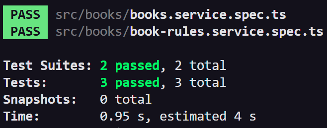

# Resultados — Pre parcial práctico 2

Completar después de realizar las peticiones. Sustituir los ejemplos por los IDs utilizados y registrar el resultado obtenido, no solamente el esperado.

| Petición y datos utilizados | Código esperado | Código obtenido | Observación |
| --- | --- | --- | --- |
| Crear un libro con 0 copias y una categoría existente. | 201 | 201 | |
| Crear con copias como texto o una propiedad adicional. | 400 | 400 | |
| Crear con una categoría inexistente. | 404 | 404 | |
| Prestar y consultar el descuento guardado. | 200 | 200 | |
| Intentar prestar un libro con 0 copias. | 409 | 409 | |
| Intentar prestar con ID abc. | 400 | 400 | |
| Intentar prestar con ID entero inexistente. | 404 | 404 | |

## Pruebas

Pegar el resumen de `npm test` o registrar el resultado de cada una de las tres pruebas.

| Prueba | Resultado obtenido |
| --- | --- |
| 1. Regla real: sin copias. | Passed |
| 2. Servicio: préstamo exitoso. | Passed |
| 3. Servicio: rechazo sin guardar. | Passed |

## Comprensión del ejercicio

Explicar brevemente, señalando el propio código, por qué registrar un libro con 0 copias está permitido, pero prestar ese mismo libro no.

Respuesta: Registrar un libro con 0 copias esta permitido ya que en las validaciones del dto tenemos que el min de copias permitido es 0 (@Min(0)). Sin embargo, prestar ese mismo libro con 0 copias no esta permitido, ya que en bookRulesService el metodo verifica si las copias son igual a 0, y si es asi, el metodo lanza un error, que significa que no hay copias disponibles, osea que no puedes prestar un libro que no tiene copias :p
